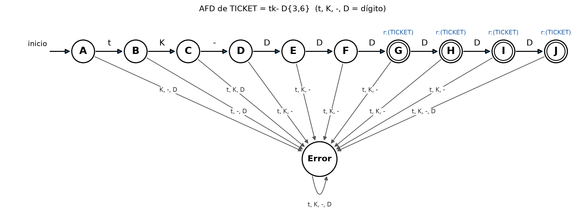

# TP1 · Informe técnico — Análisis de conversaciones de soporte de Internet

Diseño de Compiladores · FPUNA 2026/2 · Tema 1: Speech Analytics.

Este informe explica cómo funciona el analizador de punta a punta: qué hace cada fase, qué técnica de clase aplica,
cómo se conectan y qué decisiones se tomaron. Los detalles de cada fase están en los documentos de apoyo:

| Tema | Documento |
|---|---|
| Léxico, ER/AFN/AFD de `TICKET`, tabla de símbolos léxica | `INFORME_lexico.md` |
| BNF, PRIM/SGTE, tabla LL(1), parser y recuperación | `GRAMATICA.md` |
| Derivación de la gramática descriptiva a la LL(1) | `DERIVACION.md` |
| Perfiles, cuadros BNF \| reglas semánticas, estado, árboles anotados | `REGLAS_SEMANTICAS.md` |
| Esperado frente a obtenido por caso | `RESULTADOS_PRUEBAS.md` |
| Uso y decisiones de diseño | `README.md` |

Todas las cifras de este informe salen de ejecutar el proyecto (`python3 gramatica.py`, `python3 pruebas.py`,
`python3 lexico.py`).

---

## 1. Qué resuelve

Cada archivo de entrada contiene sesiones de soporte:

```
SESION S01
1 CLIENTE: El servicio está lento.
2 AGENTE: Reinicie el router.
3 CLIENTE: Ahora funciona bien.
FIN
```

Por sesión, el analizador informa:

- **Valoración por turno y resumen por aspecto** (SERVICIO, ATENCION, CLARIDAD): POSITIVA, NEGATIVA, NEUTRA, MIXTA o
  SIN_EVIDENCIA. Solo cuenta la evidencia del CLIENTE; las opiniones del AGENTE se conservan aparte.
- **Estado conversacional**: RESUELTO, NO_RESUELTO, TEMPORAL, PENDIENTE o NO_CONFIRMADO.
- **Evidencias**: cada valoración o declaración lleva su turno, el fragmento de texto y las reglas aplicadas.
- **Entidades** (sesión, participantes, tickets), **correcciones**, **errores** y fragmentos **NO_INTERPRETADO**.

La trampa central del enunciado es no confundir una valoración positiva con una confirmación de solución: «Me
atendiste muy bien, pero sigo sin internet» es ATENCION POSITIVA y SERVICIO NEGATIVA, con estado NO_RESUELTO.

## 2. Arquitectura

Cada etapa corresponde a una fase clásica de un compilador:

```
archivo.txt
  │ lector.py ....... gramática de FORMATO, línea a línea: SESION / n ROL: texto / FIN
  ▼                    (normaliza a NFC, tolera BOM; un EOL es un punto de sincronización)
  │ lexico.py ....... AFD construido con ER → AFN (Thompson) → AFD (subconjuntos); lexema más largo + prioridad
  │                    └─ diccionario de la TABLA DE SÍMBOLOS LÉXICA (tabla_lexica.py)
  ▼
  │ corrector.py .... Levenshtein ≤ 1 sobre las palabras desconocidas
  │ consulta.py ..... si el corrector no resuelve (empate o sin candidato): pregunta al usuario y enriquece la tabla
  ▼
  │ sintaxis.py ..... parser LL(1) predictivo guiado por la tabla M[A, a]; recuperación en modo pánico
  │ gramatica.py ...  BNF, PRIM, SGTE, tabla M, verificación LL(1)
  ▼
  │ semantica.py .... reglas semánticas por producción → «hechos»; rasgos y perfiles; compatibilidad; estado
  │ entidades.py .... TABLA DE ENTIDADES por sesión (SESION, PARTICIPANTE, TICKET)
  ▼
  analizador.py + main.py → JSON por lote, vista de consola y traza
```

Python 3.10+, solo biblioteca estándar. El léxico no usa el módulo `re`: el AFD se construye con los algoritmos de
clase.

### 2.1 Qué tipo de procesador es: ASP con semántica separada, no un TDS

Los apuntes describen dos formas de organizar un procesador de lenguaje. Este proyecto sigue la primera: un compilador
por etapas cuyo analizador sintáctico es un analizador sintáctico predictivo (ASP) y cuya semántica es una etapa
aparte.

| Criterio | Qué dicen los apuntes | Qué hace el proyecto |
|---|---|---|
| Etapas | «El compilador especializa las tareas en diferentes etapas, mientras que el traductor dirigido por sintaxis las unifica» (Clase 4 §4.4). El TDS agrupa léxico, sintáctico y semántico «en un solo paso, generando el lenguaje de salida directamente» (Clase 1 §1.1.2) | Etapas separadas, cada una en su módulo: lector, AFD, corrector, parser, semántica y tabla de entidades. El léxico no conoce la gramática y el parser no calcula valoraciones |
| Parser | El ASP usa «una pila y una tabla de análisis sintáctico M para decidir qué producción aplicar» según el no terminal y el token actual, y emite una derivación por la izquierda (Clase 8, Def. 8.1.1) | `parse(A)` decide con `M[A, a]` y emite esa misma derivación; `python3 main.py … --traza S01 --detalle` la muestra producción por producción |
| Semántica | El ASP «no evalúa por sí mismo reglas semánticas», que «puede implementarse por separado» (Clase 8, Aclaración 8.4.1) | `semantica.py` evalúa las reglas sobre el árbol ya construido (`REGLAS_SEMANTICAS.md` §1) |
| Salida | El TDS genera el lenguaje de salida mientras reconoce | No se traduce en una pasada: se construye el árbol, se calcula un hecho por cláusula y recién después se combina por aspecto y estado, que dependen de la sesión completa (§7.4) |

**Lo que sí se toma del TDS.** La notación de la semántica: el cuadro BNF | reglas semánticas, con los atributos
sintetizados como valor de retorno y los heredados como parámetro (Clase 2, Nota 2.1.1), que se usa en §7. Esa notación
es la de una definición dirigida por la sintaxis; lo que el proyecto no adopta es la arquitectura de un solo paso del
traductor dirigido por la sintaxis.

**Por qué el parser es recursivo y no usa una pila explícita.**

1. *Es una forma de los apuntes.* La gramática predictiva se convierte en código con una función por no terminal y
   `match()` por terminal (Clase 1 §1.1.5; Clase 3 §3.2.2). El proyecto conserva esa estructura y reemplaza los
   `if (preanálisis == …)` por la consulta a M.
2. *Hay que devolver el árbol.* Los apuntes señalan que «una pila que solo contiene símbolos gramaticales no basta para
   almacenar y devolver atributos sintetizados» y que integrar acciones semánticas en la pila exige gestionar sus valores
   y el momento de evaluarlas; el profesor no consideró conveniente tratarlo en clase (Clase 8 §8.4.2). Con recursión,
   el árbol sale como valor de retorno, y la semántica puede quedar en una etapa separada.
3. *La tabla no se escribe a mano.* `gramatica.py` la calcula desde la gramática (PRIM, SGTE y M) y el parser solo la
   consulta, así que tabla y parser no se desincronizan al cambiar una producción.

**Equivalencia y límite.** Los apuntes presentan por separado el ASP con pila explícita (Def. 8.1.1) y la forma
recursiva (§1.1.5); reunirlas es una decisión de diseño del grupo. Sobre entradas sin errores la derivación es la misma.
La recuperación de errores aplica las reglas de la Clase 8 §8.5 (sección 6.3), con una diferencia documentada: se
informa un error por celda vacía y no uno por token descartado.

## 3. Recorrido de una frase (caso 02)

Entrada: `1 CLIENTE: Me atendiste muy bien, pero sigo sin internet.` Comando:
`python3 main.py casos/caso_02.txt --traza S01 --detalle`.

| Paso | Qué ocurre | Salida de la traza |
|---|---|---|
| 1. Texto original | el lector acepta el turno 1 de CLIENTE | `[1] Texto original` |
| 2. Tokens | categoría, lexema, desplazamiento y forma canónica de cada palabra | `RELLENO«Me»@11=CLITICO V_ACC«atendiste»@14=ATENDER INT«muy»@24=MUY ADJ«bien»@28=BUENO COMA«,»@32 PERO«pero»@34 V_CONT«sigo»@39=SEGUIR SIN«sin»@44 SUST«internet»@48=SERVICIO PUNTO«.»@56` |
| 3. Estructura | árbol de derivación LL(1) (se filtra el RELLENO «Me») | `texto[oracion[clausula[nucleo[pred_l[V_ACC«atendiste» modif_op[modif[INT«muy» ADJ«bien»]]]]] cola[COMA cola_c[PERO clausula[nucleo[pred_l[V_CONT«sigo» compl[SIN«sin» SUST«internet»]]]]]]] texto_r[PUNTO]]` |
| 4. Tabla de entidades | se busca e inserta el participante | `BUSCAR PARTICIPANTE CLIENTE → NO_EXISTE`, `INSERTAR PARTICIPANTE CLIENTE` |
| 5. Acción semántica | una regla por producción; el significado sale de los rasgos de cada forma canónica | `C1.1 «Me atendiste muy bien» → ATENCION=POSITIVA [R-VAL, R-MUY]`; `C1.2 «sigo sin internet» → SERVICIO=NEGATIVA declaración=FALLA [R-SEG-SIN, R-SIN, R-PERO]` |
| 6. Resultado | combinación por aspecto y estado | ATENCION POSITIVA, SERVICIO NEGATIVA; estado **NO_RESUELTO** (`R-EST-NORES`) |

## 4. Léxico y normalización (`lexico.py`)

**Normalización.** Cada línea se pasa a NFC; después cada carácter se pliega a minúscula y sin tilde, conservando la
`ñ`. El plegado es 1 a 1, así que el **desplazamiento** de un token sirve también para el texto original. Cada token
guarda su **lexema original** («Está»), su forma **normalizada** («esta») y su **forma canónica** (`SER_ESTAR`), con su
posición **(sesión, turno, desplazamiento)**. Los tickets se normalizan a mayúsculas.

**Categorías y prioridades.** El orden de los patrones es la prioridad:

| Prioridad | Categoría | ER |
|---|---|---|
| 1 | `SESION`, `FIN`, `CLIENTE`, `AGENTE` | literales |
| 2 | `ID_SESION` | `s D D` |
| 3 | `NUM` | `D+` |
| 4 | `DOSPUNTOS`, `PUNTO`, `COMA`, `SIGNO` | `:` · `.` · `,` · `[¿?¡!]` |
| 5 | `TICKET` | `tk- D{3,6}` |
| 6 | `TICKET_MAL` | `tk- D*` (error léxico específico) |
| 7 | las 16 categorías del vocabulario (`SUST`, `ADJ`, `V_EST`, `V_ACC`, `ADV_T`, `NEG`, `SIN`, `Y`…) | unión de las formas del diccionario vigente |
| 8 | `PALABRA` | `letra+` (palabra desconocida: entrada del corrector) |
| — | `DESCONOCIDO` | ningún patrón acepta |

Todos los patrones se combinan en un AFN con transiciones ε (Thompson) y se convierten en un único AFD por
subconjuntos: **409 estados**, de los cuales **124** reúnen finales de varios patrones y se resuelven por prioridad.
El scanner aplica **lexema más largo** (`TK-204` es `TICKET`, no `tk` como `PALABRA`) y, ante el mismo lexema,
**prioridad** (`no` es `NEG`, no `PALABRA`).

**Categoría con su ER y AFD.** `TICKET = tk- D{3,6} = tk- DDD(D(D(D)?)?)?` da un AFD de 10 estados en cadena (q0 a q9),
con finales q6 a q9 (3 a 6 dígitos); ya es mínimo. Construcción, tabla de transiciones y trazas en
`INFORME_lexico.md` §3. `TK-12` y `TK-1234567` dan `TICKET_MAL`.

**Construcción a mano, con la convención de clase.** El mismo autómata se construyó a mano. Con la convención de
clase, en la que la concatenación fusiona el final de un fragmento con el inicio del siguiente, el AFN de Thompson
tiene 22 estados, del 1 (inicial) al 22 (final); cada `( … )?` se arma como `( … | ε)`. La construcción por
subconjuntos parte de cerradura-ε({1}) y da:

| Estado AFD | Conjunto del AFN | t | K | - | D | Final |
|---|---|---|---|---|---|---|
| A | {1} | B | Error | Error | Error | no |
| B | {2} | Error | C | Error | Error | no |
| C | {3} | Error | Error | D | Error | no |
| D | {4} | Error | Error | Error | E | no |
| E | {5} | Error | Error | Error | F | no |
| F | {6} | Error | Error | Error | G | no |
| G | {7, 8, 20, 21, 22} | Error | Error | Error | H | sí |
| H | {9, 10, 17, 18, 19, 22} | Error | Error | Error | I | sí |
| I | {11, 12, 14, 15, 16, 19, 22} | Error | Error | Error | J | sí |
| J | {13, 16, 19, 22} | Error | Error | Error | Error | sí |
| Error | ∅ | Error | Error | Error | Error | no |

Son finales los conjuntos que contienen el estado 22 del AFN: G, H, I y J (3, 4, 5 y 6 dígitos). `K` es la `k` de
`tk-` (el léxico pliega a minúsculas) y `D` es la clase de los dígitos.



El grafo se genera desde `figuras/afd_ticket_cuaderno.dot` (Graphviz); `figuras/afd_ticket_cuaderno_sin_error.dot`
es la versión sin el estado `Error`.

**Coincide con el AFD del programa.** Renombrando A…J como q0…q9 se obtiene el AFD que construye `lexico.py`: las
mismas transiciones y los mismos finales (G a J son q6 a q9). Cambian dos cosas de forma: el AFN del programa tiene 25
estados porque une los fragmentos con transiciones ε en lugar de fusionarlos, y su estado de error es implícito
(transición indefinida) en lugar de un estado `Error` explícito. El AFD mínimo de una ER es único salvo el nombre de los
estados, así que la convención con la que se arma el AFN no cambia el resultado; en este caso los dos coinciden ya
antes de minimizar.

## 5. Tabla de símbolos

Hay dos tablas separadas, como pide el enunciado («mantener separado el diccionario de vocabulario»):

| | Tabla de símbolos léxica (`tabla_lexica.py`) | Tabla de entidades (`entidades.py`) |
|---|---|---|
| Qué guarda | el lenguaje | lo que aparece en cada conversación |
| Contenido | una sola estructura: categoría → forma canónica → {**rasgos**, formas superficiales} | SESION, PARTICIPANTE, TICKET y sus apariciones (turno, desplazamiento, lexema) |
| Ámbito | global | la sesión |
| Persistencia | sí, entre ejecuciones; se enriquece con el usuario | no: se crea vacía en cada ejecución |
| Operaciones | buscar, insertar, alta de forma canónica, reinicio | buscar, insertar (enlaza duplicados), actualizar |

### 5.1 Tabla de símbolos léxica: persistente e interactiva

Siguiendo la respuesta del profesor, la tabla se **precarga** a mano y se **enriquece** sesión a sesión:

| Archivo | Contenido |
|---|---|
| `vocabulario.json` | precarga `{categoría: {canónico: {"rasgos": {...}, "formas": [...]}}}` (16 categorías con formas, 43 formas canónicas, 116 formas, más `FUERA_DE_GRAMATICA/FUERA`). El programa nunca lo modifica |
| `vocabulario_aprendido.json` | lo aprendido, **con el mismo formato** (una forma canónica nueva trae sus rasgos; una de la precarga, solo las formas nuevas). Una escritura atómica por cambio |

**Cómo se resuelve el significado de una palabra.** La misma entrada de la tabla guarda las formas y los rasgos:

```
forma ──(tabla de símbolos léxica)──► categoría + forma canónica + rasgos ──(semantica.sig)──► atributos
«lentas»                               ADJ / LENTO / {"pol": -1}                              pol = −1
```

Los rasgos no son libres. Los **perfiles** (`semantica.PERFILES`, 33 en total) son el catálogo cerrado de
combinaciones válidas por categoría, por ejemplo `ADJ`: POSITIVO `{"pol": 1}`, NEGATIVO `{"pol": -1}`, SIN_DOMINIO
`{"sin_dominio": true}`; `V_EST`: OK, FALLA, RECUR `{"pol": -1, "decl": "RECUR", "pronominal": true}`. Al abrir la tabla
se valida que los rasgos de cada forma canónica (precarga y aprendida) coincidan con un perfil; si no, la tabla no se
abre y se informa la entrada.

**Consulta al usuario.** Se pregunta **después del corrector**, solo si la regla del enunciado no resuelve la palabra:

| Corrector | Consulta |
|---|---|
| un candidato a distancia 1 | no se pregunta: se corrige |
| empate | se ofrecen los candidatos (corrige solo esa aparición), insertar o mantener el empate |
| sin candidato | insertar o dejarla NO_INTERPRETADA |

Al insertar, el **menú es cerrado**: 1) categoría (solo las existentes); 2) forma canónica de la que es variante (se
ofrecen primero las existentes de la categoría, o se crea una nueva con nombre normalizado y sin duplicados); 3) si es
nueva, un **perfil existente** de la categoría (obligatorio); el programa copia sus rasgos en la entrada nueva. Lo aprendido vale para el resto de la misma entrada y
para las ejecuciones siguientes. `python3 main.py --reiniciar-aprendido` vuelve a la precarga. No hay archivo
de auditoría: lo aprendido se ve con `python3 main.py --tabla` («+» = aprendido) y, por ejecución, en las correcciones
`INSERTADA` del JSON de resultados (turno, categoría, forma canónica).

Ejemplo verificado: «El internet colapsa seguido.» → «colapsa» sin candidato → `V_EST`, forma canónica nueva
`COLAPSAR`, perfil `FALLA` (rasgos `{"pol": -1, "decl": "FALLA"}`) → SERVICIO NEGATIVA, FALLA, NO_RESUELTO; en la
ejecución siguiente ya no se pregunta.

**`SIN_DOMINIO`.** Para palabras que la gramática debe reconocer pero sin significado para el dominio («hace», «ruido»,
«técnico»): la cláusula se reconoce entera y no se interpreta. Con «hace», «ruidos» y «raros» registradas con el rasgo `sin_dominio`,
«Mi router hace ruidos raros» se abstiene; si esas palabras se descartaran antes del parser, el parser uniría «el
router … raros» y diría SERVICIO NEGATIVA.

**Modo no interactivo.** `pruebas.py` y el golden no preguntan y usan solo la precarga: los resultados esperados no
dependen de lo que se haya respondido antes.

### 5.2 Por qué los rasgos están en la misma tabla

Se probó guardar el significado aparte (`significados.json`: forma canónica → perfil, y lo aprendido en dos archivos).
Se volvió a una sola estructura por cómo funciona la interactividad de la tabla:

1. **Atomicidad.** Un alta desde el menú crea la forma canónica y su significado. En un archivo es una sola escritura
   atómica; con dos, cada escritura era atómica pero el cambio no, y si un archivo se borraba, restauraba o copiaba
   sin el otro, quedaban formas sin significado y la tabla no cargaba.
2. **Vigencia inmediata.** El corrector y la semántica usan el mismo objeto vivo (`tabla.vocabulario()`): lo aprendido
   en un turno vale en el siguiente sin sincronizar dos estructuras.
3. **Menú coherente.** Las opciones de variante muestran los rasgos de la misma entrada en la que se inserta.
4. **Mismo formato en precarga y aprendido.** Pasar algo aprendido a la precarga es copiar una entrada; la conciliación
   y el reinicio trabajan sobre un archivo.
5. **El menú sigue cerrado.** Los rasgos se copian de un perfil y la carga rechaza combinaciones fuera del catálogo.

Costo: los rasgos se repiten en cada forma canónica del mismo perfil; si se cambia un perfil en el código, la
validación señala las entradas a actualizar. Detalle en `INFORME_lexico.md` §1.6.

### 5.3 Tabla de entidades

Se llena durante el análisis: `buscar` + `insertar` de la sesión al empezar, del participante en cada turno aceptado y
de cada ticket; `actualizar` del ticket cuando la semántica detecta un compromiso sobre él y de la sesión al final, con
su estado. Insertar una clave existente no duplica: **enlaza** la aparición (`TK-310` mencionado dos veces = una
entrada con dos apariciones). Todas las operaciones quedan en la bitácora que muestra la traza (paso `[4]`).

## 6. BNF y análisis sintáctico

### 6.1 Gramática

Dos niveles: la **gramática de formato** (archivo, sesión, turno), que el lector procesa línea a línea, y la
**gramática lingüística** del texto de un turno, que procesa el parser LL(1). La lingüística describe construcciones
con categorías generales; qué significa cada palabra lo resuelve la semántica.

```
<texto>    ::= <oracion> <texto_r>
<texto_r>  ::= PUNTO <texto_rr> | ε
<texto_rr> ::= <oracion> <texto_r> | ε
<oracion>  ::= <clausula> <cola>
<cola>     ::= PERO <clausula> <cola> | COMA <cola_c> | Y <clausula> <cola> | ε
<cola_c>   ::= PERO <clausula> <cola> | <clausula> <cola>
<clausula> ::= <adv_t_op> <nucleo> <frec>
<adv_t_op> ::= ADV_T | ε
<nucleo>   ::= <sujeto> <pred_s> | <pred_l> | TICKET | CORTESIA
<sujeto>   ::= SUST | AGENTE
<pred_s>   ::= NEG <pred_neg> | V_COP <atrib> | V_EST <compl> | SE V_EST <compl> | V_CONT <compl>
             | V_ACC <obj> <modif_op> | <modif> | TICKET | ε
<pred_l>   ::= NEG <pred_neg> | V_COP <atrib> | V_EST <compl> <sujp> | SE V_EST <compl> <sujp> | V_CONT <compl>
             | V_ACC <obj> <modif_op>
<pred_neg> ::= V_COP <atrib> | V_EST <compl> <sujp> | SE V_EST <compl> <sujp> | V_CONT <compl> | V_ACC <obj> <modif_op>
<atrib>    ::= <modif> | TICKET
<compl>    ::= <modif> | SIN SUST | ε
<sujp>     ::= SUST | ε
<obj>      ::= SUST | TICKET | ADV_T | ε
<modif>    ::= INT ADJ | ADJ          <modif_op> ::= <modif> | ε          <frec> ::= FREC <frec> | ε
```

`pred_s` es el predicado que sigue a un sujeto; `pred_l`, el que va sin sujeto delante (tácito o pospuesto, `sujp`);
`pred_neg`, el alcance de `NEG`. Los verbos se agrupan por construcción: `V_COP` + cualidad, `V_EST` (estado del
servicio, con o sin «se»), `V_CONT` («seguir») + complemento, `V_ACC` + objeto.

**En números:** 27 variables (7 de formato, 20 lingüísticas), 68 producciones, 19 terminales en el texto de un turno.

### 6.2 De la gramática descriptiva a la LL(1)

Siguiendo el consejo de clase («primero describir el lenguaje, después hacerlo predictivo y comprobar que no se
introdujo basura»), `DERIVACION.md` parte de una gramática descriptiva (L0) y aplica:

1. **Eliminación de la recursión por la izquierda** (`A → Aα | β` ⇒ `A → βR`, `R → αR | ε`) en `lista`, `oracion` y
   `frec`.
2. **Factorización por la izquierda** (`A → αβ₁ | αβ₂` ⇒ `A → αR`), por ejemplo las diez alternativas de `nucleo` que
   empiezan con `sujeto`.
3. **Resolución de un conflicto PRIM∩SGTE** que introduce el paso 1 (`PUNTO` en `lista_r`): se consume el punto y se
   decide después.

Cada gramática se diagnostica con el código, y las cuatro generan el mismo lenguaje: **23 220 cadenas de hasta 5
tokens**, verificación acotada.

### 6.3 Verificación LL(1) y parser

`gramatica.py` calcula PRIM y SGTE (iteración hasta punto fijo, algoritmos de las Clases 6 y 7), construye la tabla
predictiva `M` (Clase 7, §7.5) y verifica las condiciones LL(1): sin recursión por la izquierda, PRIM de las
alternativas disjuntos y, para las anulables, SGTE disjunto de los PRIM de las demás. **Resultado: ningún conflicto;
la tabla tiene 170 celdas.**

`sintaxis.py` es un **analizador predictivo recursivo guiado por la tabla M**. Toma la estructura de los apuntes
(Clase 1 §1.1.5: un procedimiento por no terminal y `match()` por terminal), pero la decisión no sale de
`if (preanálisis == …)` sino de `M[A, a]` (Clase 7 §7.5), como en el ASP de la Clase 8. Un único procedimiento `parse(A)`
consulta `M[A, lookahead]`, emite la producción y llama a `parse()` o `_match()` por cada símbolo del cuerpo. Devuelve
el árbol de derivación, que es lo que evalúa después la semántica (§2.1). Dentro de un turno, `EOL` cumple el papel
de `$`. En una entrada sin errores, el orden en que `parse()` expande las variables es una derivación por la izquierda
con las mismas celdas de M que usaría el ASP con pila explícita; la diferencia es de implementación: los símbolos
pendientes están en la pila de llamadas y no en una estructura explícita.

**Recuperación de errores** (Clase 8, §8.5.4): terminal esperado distinto del token → se informa sin consumir;
`M[A, a]` vacía → se descartan tokens hasta uno de PRIM(A) ∪ SGTE(A) ∪ {EOL}; token de SGTE(A) → se abandona `A`. Una
cláusula con error queda marcada y no se interpreta; el resto del turno sigue.

## 7. Reglas semánticas y estado (`semantica.py`)

### 7.1 Definición dirigida por la sintaxis

Cada producción tiene una regla registrada con `@acc(variable, producción)` que calcula atributos **sintetizados** y
los devuelve al padre (46 reglas). El actor, el turno y el conector bajan desde el turno como atributos
**heredados**. Los terminales con significado aportan los **rasgos** de su forma canónica (`tok.p`, leídos con `semantica.sig`). Ejemplos, en la notación de
clase:

| BNF | Regla semántica |
|---|---|
| `modif → INT ADJ` | `modif.pol = ADJ.p.pol; modif.int = ALTA` |
| `compl → SIN SUST` | `compl.pol = (SUST.p.pol = −1) ? +1 : −1` («sin internet» −1, «sin cortes» +1) |
| `pred → V_EST compl` | `pred.k = EST; pred.pol = (V_EST.p.pol = −1) ? −1 : (compl ? compl.pol : +1)` |
| `pred_l → NEG pred_neg` | copia `pred_neg`; `pred.neg = verdadero` (la inversión se hace una sola vez) |
| `nucleo → sujeto pred_s` | `nucleo.h = construir(pred_s, sujeto)` |

`construir()` convierte el predicado en un **hecho**: verifica la compatibilidad, calcula aspecto, polaridad
(invertida si hay negación), declaración de funcionamiento (OK, FALLA, RECUR; solo sobre el SERVICIO) y tipo.

### 7.2 Negación y contraste

El alcance lo fija la gramática: `NEG` solo precede a `pred_neg` y `SIN` a un sustantivo; ninguno cruza `PERO`, `COMA`,
`Y` ni `PUNTO`, porque después de un conector empieza otra derivación de `clausula`. En «No entendí la explicación,
pero el agente fue amable» la negación afecta solo a la primera cláusula. `PERO` deja las dos cláusulas en contraste
y conserva ambas evidencias.

### 7.3 Compatibilidad y abstención

La gramática es general y acepta combinaciones sin sentido. La semántica las descarta antes de interpretar, como el
chequeo de tipos de un compilador:

| Regla | Qué detecta | Ejemplo |
|---|---|---|
| R-COMPAT | sujeto y predicado incompatibles (tabla `COMPAT`); «se» con un verbo que no es RECUR, o RECUR sin «se»; dos sujetos | «El agente se corta», «El agente corta la llamada» |
| R-SINDOM | una palabra con el rasgo `sin_dominio` en la cláusula | «Mi router hace ruidos raros» (con esas palabras registradas) |

La cláusula se reconoce pero no se interpreta: sus palabras quedan NO_INTERPRETADO con el motivo. Nunca se inventa una
valoración por haber reconocido solo una parte.

### 7.4 Valoración por aspecto y estado

- **Valoración**: POSITIVA y NEGATIVA del mismo aspecto → **MIXTA** (no se promedia ni se cancela); una sola → esa;
  solo menciones → NEUTRA; nada → SIN_EVIDENCIA. El resumen usa solo la evidencia del CLIENTE.
- **Estado**: se recorren las declaraciones del cliente por turno (OK → RESUELTO; FALLA → NO_RESUELTO; OK y RECUR en el
  mismo turno, o RECUR después de una recuperación → TEMPORAL). Sin declaraciones: compromiso del agente → PENDIENTE;
  si no, NO_CONFIRMADO.
- **Precedencia** (respuesta del profesor, `R-EST-PREC`): **prevalece lo último**. Una promesa del agente posterior a
  la última declaración del cliente deja la sesión PENDIENTE; si el cliente declara después, prevalece el cliente.
  Interruptor `LO_ULTIMO_PREVALECE`.

## 8. Corrección y recuperación

| Situación | Tratamiento |
|---|---|
| Palabra desconocida, un candidato a distancia 1 | se corrige («lentto» → «lento», caso 05) |
| Empate a distancia 1 | se conserva y se registra el empate (caso 08: «lent» frente a «lenta» y «lento»); en modo interactivo se ofrecen los candidatos |
| Sin candidato | NO_INTERPRETADO, o se inserta en la tabla léxica |
| Palabra de menos de 4 letras | no se corrige ni se pregunta (evita «mas» → «mal») |
| `no`, números, `TK-…` | nunca se corrigen: no son `PALABRA` |
| Rol inválido | se rechaza el turno y se sigue (caso 07) |
| Orden inconsistente | respuesta del profesor: se conserva lo anterior y se descarta el resto de la sesión (casos 12 y 14) |
| Id de sesión repetido, línea en blanco, sesión sin `FIN` | se registra el error; las demás sesiones se analizan |
| Error sintáctico en un turno | modo pánico; la cláusula con error no se interpreta |

Una sesión es **PARCIAL** si tuvo un turno rechazado o descartado, o le falta `FIN`.

## 9. Pruebas y reproducibilidad (`pruebas.py`)

| Qué | Resultado |
|---|---|
| 19 casos (8 de la guía, 11 propios; el 11 se eliminó y la numeración se conserva), 27 sesiones, esperado explícito en `casos/casos.json` | todos OK |
| Casos 19 y 20 (palabras fuera del vocabulario): respuestas simuladas al menú, preguntas esperadas y resultado sin consulta | todos OK |
| Regresión: JSON completo contra `casos/golden/` | idéntico |
| 13 pruebas de la tabla léxica con respuestas simuladas (preguntas después del corrector, empate, alta de forma canónica con los rasgos del perfil, duplicados, SIN_DOMINIO, persistencia en un archivo, rasgos validados al cargar, reinicio…) | todas OK |
| Mutación: MIXTA promediada a POSITIVA | detectada por los casos 01, 03, 07, 10, 12, 13, 16, 17, 18 y 19 |
| Mutación: la negación no invierte | detectada por los casos 04, 09, 14, 16, 17 y 18 |

Las pruebas no preguntan y usan solo la precarga. Los casos 19 y 20 traen en `casos.json` las respuestas al menú
(simbólicas, resueltas en el momento de la pregunta) y se corren sobre una tabla de símbolos léxica **solo en memoria**
creada desde la precarga; se verifica también por qué palabras se preguntó y el resultado sin consulta. Los casos 17 a
20 cubren el alcance del enunciado (§1): lentitud y reinicio del router (17), cortes y seguimiento de tickets (18),
falta de conexión con palabras insertadas como variantes (19) y formas canónicas nuevas (20). Para cada caso,
`RESULTADOS_PRUEBAS.md` muestra el esperado, el obtenido y las reglas activadas.

**Límite detectado en la revisión.** Una palabra desconocida que el usuario no inserta se descarta antes del parser,
y el parser une lo que queda. Si lo que se pierde es el sujeto, la cláusula toma el aspecto por defecto: «…pero el
técnico fue amable» se interpreta como «fue amable» → **SERVICIO POSITIVA**. Registrar la palabra con perfil
SIN_DOMINIO lo evita. Se probó en una copia una regla general (**R-DESC**: abstenerse si en el tramo de la cláusula se
descartó una palabra desconocida). Corrige el caso; cuando se midió, solo cambiaba el turno «Muchas gracias» del
caso 11, que ya no está en la batería (con los casos actuales no se volvió a medir). Queda propuesta para decidir en
el grupo.

## 10. Decisiones de diseño

| Decisión | Por qué |
|---|---|
| El lexer no ve contexto (`agente` es siempre `AGENTE`) | separación de fases: el parser decide si es rol o sujeto |
| `TICKET_MAL` como patrón propio | error léxico específico en lugar de `PALABRA - NUM` |
| Tabla de tres niveles con los rasgos en cada forma canónica; perfiles cerrados en el código | la gramática queda chica y general; una palabra nueva se agrega sin código; un significado nuevo sí es un cambio del modelo |
| Rasgos en el mismo JSON, no en un archivo aparte | una escritura atómica por cambio, un solo objeto vivo para lo aprendido y el mismo formato en precarga y aprendido (§5.2) |
| Menú de inserción cerrado | el usuario no puede crear categorías, perfiles ni rasgos que la gramática o la semántica no conozcan |
| Consulta solo después del corrector | respeta la regla del enunciado; solo se pregunta lo que la regla no resuelve |
| `SIN_DOMINIO` en lugar de descartar la palabra | evita que el parser una lo que queda y se invente una valoración |
| Compatibilidad sujeto–predicado en la semántica | la gramática general acepta de más; es el chequeo de tipos |
| `PUNTO` obligatorio entre oraciones | mantener la gramática LL(1) |
| Negación con alcance gramatical | no cruza conectores; se explica con el árbol |
| MIXTA = ambas polaridades | el enunciado prohíbe promediar |
| «Está lento» no fija estado | es una valoración, no una declaración de funcionamiento |
| Prevalece lo último; orden inconsistente descarta el resto | respuestas del profesor |
| Dos tablas: léxica persistente, entidades efímera | el profesor pidió enriquecer la tabla; el enunciado, separar el vocabulario |

## 11. Límites conocidos

- Fuera de la gramática: «sin» + verbo («sigue sin funcionar»), dos complementos («revisaremos TK-204 mañana»),
  adjetivo suelto sin sujeto ni cópula («muy lento») y el demostrativo «esta», que se confunde con «está».
- Una forma tiene una sola categoría: los homógrafos («falla», «corte») se leen de una sola manera. Los tiempos
  verbales no se distinguen (fuera del alcance).
- Palabras desconocidas descartadas antes del parser (sección 9).
- Desde el menú no se crean categorías ni perfiles: un significado nuevo requiere código; una construcción nueva
  requiere cambiar la gramática.
- La equivalencia entre gramáticas se verifica por enumeración acotada, no se demuestra.
- Pendiente de confirmar con el profesor: si un turno rechazado (con `FIN` presente) vuelve PARCIAL la sesión. Hoy sí,
  porque así lo pide el caso 07 de la guía.
